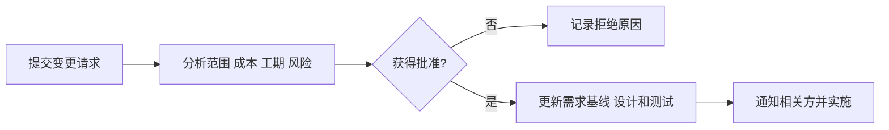
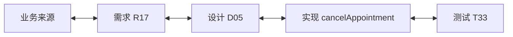
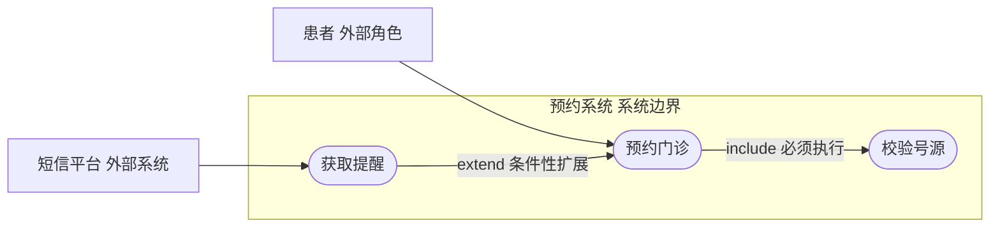
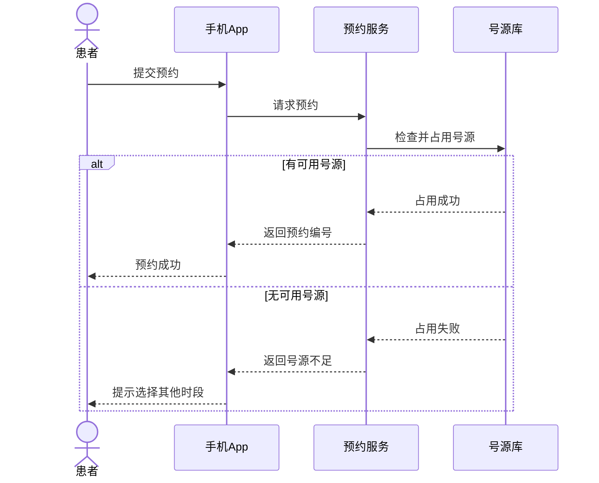
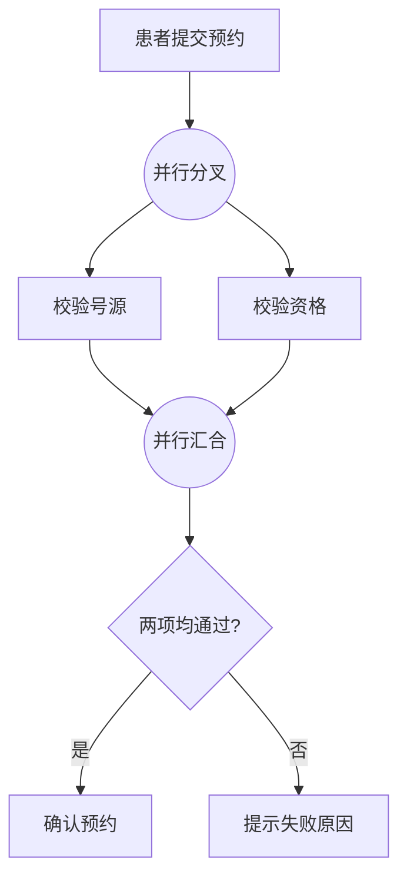
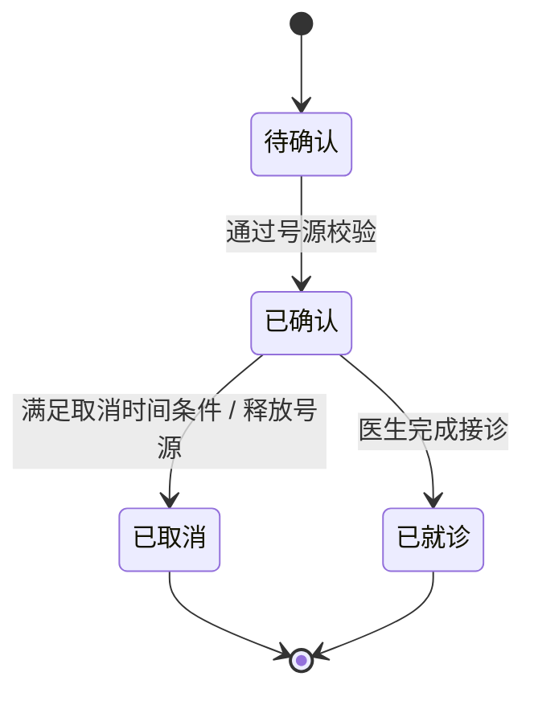
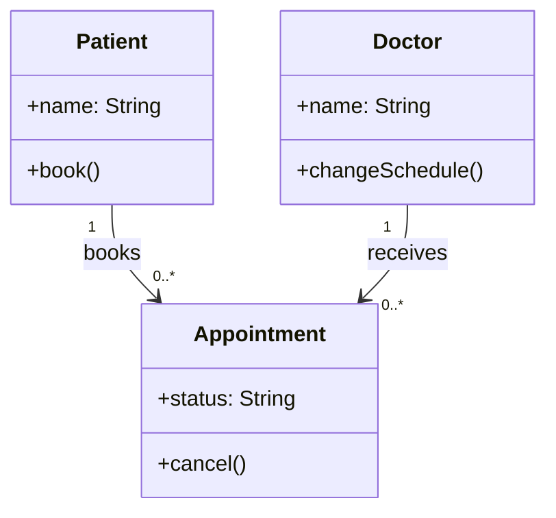
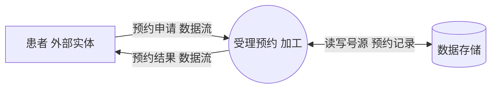

# 第1天｜系统分析师零基础入门课

**贯穿案例：社区医院预约系统。**

**方法：** 先读懂 → 不看资料复述 → 做原创理解题 → 分析错因 → 隔天复测。读过不等于掌握。

**来源说明：** 本讲义为独立编写的入门教学材料。练习题均为原创，不是官方真题，也不属于现有150道题库。

## 1. K001 需求类型

**一句话：** 功能需求管“要做什么”，非功能需求管“做到什么标准”。

**为什么要学：** 系统分析师要先把模糊愿望变成可实施、可验收的需求。分类是为了避免开发人员只实现按钮，却忘了速度、安全或可靠性。

**医院故事：** 医院要做手机预约：患者希望预约和取消；医院希望预约时系统速度快、病历不能被别人看。

### 先理解“需求”
需求是利益相关方对系统提出的需要或限制。不是程序员想做的按钮，而是业务方、患者、医生等真正需要实现的目标。

### 功能需求（Functional Requirement）
描述系统提供的业务行为。例：查询医生排班、提交预约、取消预约、发送成功通知。判断线索通常是“谁能做某事”。

### 非功能需求（Non-functional Requirement, NFR）
描述质量属性、性能或约束。例：“正常负载下95%的预约查询在2秒内完成”、可用性、安全、兼容性、审计要求。关键是定义可检测条件。

### 不要靠关键词机械分类
“管理员可以配置角色权限”是具体管理功能；“未授权用户不得查看他人病历”是安全约束。带“安全”二字不代表所有句子都属于同一类。

### 带你做：把医院的四句愿望分类

1. “患者可取消预约”→功能：描述业务动作。
2. “预约请求在2秒内返回结果”→非功能：规定性能，但最好说明统计口径与比例。
3. “系统提供权限配置页面”→功能：规定系统要有的操作能力。
4. “患者不能访问其他人的病历”→非功能：规定保密性/授权约束；实现中也会衍生具体权限功能。

**容易混淆：** 常混淆：功能需求=“系统会做什么”；非功能需求=“功能做得怎么样/受哪些限制”。性能要求需带负载、比例和测量方式，单写“很快”无法验收。

**考试可能怎样问：** 综合知识会考分类；案例分析会要求发现需求缺陷并写成可验证描述。

**记忆钩子：** 做什么→功能；做到什么程度→非功能。

### 闭卷自述

1. 不看资料，举出预约系统2个功能需求、2个非功能需求。
2. 把“系统必须好用”改写成至少一个可检查的要求。

### 两道原创理解题（请先选，再展开答案）

**LQ-D1-K001-01：以下哪项主要属于非功能需求？**

- A. 患者能取消预约
- B. 医生能修改排班
- C. 95%的预约查询在2秒内响应
- D. 管理员能维护医生资料

完成后查看正确答案和逐项解析

**答案：C**

- A：取消预约是一项业务操作。
- B：修改排班是一项业务操作。
- C：正确：规定响应时间和达标比例，属于性能约束。
- D：维护医生资料是一项业务操作。

**LQ-D1-K001-02：需求“预约系统要很快”不够可验收。下列哪种改写最合理？**

- A. 让测试人员上线后自行决定合格阈值
- B. 只写“平均响应不超过2秒”，不定义测试时的用户量
- C. 在指定并发负载下，规定95%请求的响应时间阈值和测量方法
- D. 先采购高配置服务器，再决定是否写性能指标

完成后查看正确答案和逐项解析

**答案：C**

- A：指标需与业务方确认，不能到验收时临时决定。
- B：平均值容易掩盖慢请求，且缺少负载条件。
- C：正确：负载、响应时间分位与测量规则共同构成可测要求。
- D：性能需求应先形成约束，采购方案是后续设计决策。

**衔接：** 下一张 K002 学习：什么叫“写得好、能验收”的需求。

---

## 2. K002 好需求6项

**一句话：** 好需求不是“听上去不错”，而是每个人理解一致、能开发、能验收。

**为什么要学：** 写错需求比写错代码代价更大。开发完成才发现需求有歧义，可能需要重做界面、接口甚至数据库。

**医院故事：** 医院说“老人预约要方便、系统要稳定”，开发团队各有理解：有人增加放大字体，有人做电话预约，最后谁也无法判定合格。

### 六项检查口径
正确：满足真实业务；无歧义：不同人读完理解相同；完整：边界、条件、异常写清；一致：不和其他需求冲突；可验证：能设计验收方法；可追溯：可找到来源及对应实现测试。

### 另外还要评估
可行性：在预算、技术与时间约束下能否实现；必要性：是否真的值得做。两者常作为扩展质量要求，不是原六项中的替代项。

### 把模糊要求变得可测
“系统稳定”不能直接验收，可改为“每个自然月核心预约服务可用性不低于99.9%，按照约定监控口径统计”。指标只是教学示例，真实项目需要业务方确认。

### 从三种风险查需求
对一个句子问：谁在什么条件下做什么？成功/失败怎么办？怎么证明符合要求？这能快速发现遗漏、歧义和不可测问题。

### 带你做：审查“用户在高峰时可以快速预约”

1. 指出“用户”范围不清：患者？医生？代办人员？
2. 指出“高峰”不清：每秒多少请求？
3. 指出“快速”不可测：要求给出95分位响应时间阈值。
4. 补充失败处理：号源不足时应提示，不得生成重复预约。

**容易混淆：** “高效、稳定、方便、及时、尽可能、必要时”等模糊词没有可操作定义，优先怀疑不可验证或存在歧义。

**考试可能怎样问：** 案例题常要求找出需求说明书的缺陷；按“缺什么、为什么有风险、怎么改”答更容易得分。

**记忆钩子：** 六项：正、清、全、一、验、追；再问可行与必要。

### 闭卷自述

1. 不看卡片说出六项质量要求，并分别用一句话解释。
2. 将“患者可以方便快捷地预约”改成可验收的版本。

### 两道原创理解题（请先选，再展开答案）

**LQ-D1-K002-01：业务方只写“预约系统应尽可能快地返回查询结果”。这条需求最直接违背了什么原则？**

- A. 可追溯性：只要没编号就必然不合格
- B. 必要性：用户一定不需要性能要求
- C. 可验证性：没有可测指标及测量条件
- D. 一致性：与另一条具体需求存在冲突

完成后查看正确答案和逐项解析

**答案：C**

- A：编号可以辅助追踪，但不能仅凭没有编号判断追溯缺失。
- B：性能需求可能非常必要，不可直接推断。
- C：正确：没有速度阈值和场景就无法判定测试是否通过。
- D：题干没有给出与其他需求冲突的证据。

**LQ-D1-K002-02：需求 A：“患者任何时候都可以取消”，需求 B：“就诊前24小时内不能取消”。应先怎样处理？**

- A. 只保留较晚录入的需求，默认它覆盖旧需求
- B. 由开发人员在代码中自行选择限制更严格的一条
- C. 交给测试团队编写两个相反预期的用例后再决定
- D. 检查两条需求的一致性，澄清适用条件和业务例外

完成后查看正确答案和逐项解析

**答案：D**

- A：时间先后不等于批准的业务优先级。
- B：开发人员无权擅自替代业务规则决策。
- C：相反的验收预期不能替代需求澄清。
- D：正确：先解决规范冲突，明确条件、优先级和例外，再设计验收。

**衔接：** 下一张 K003：怎么从患者、医生、管理人员那里获取可靠需求。

---

## 3. K003 需求获取

**一句话：** 需求获取就是通过问、看、试，把业务中真实的痛点找出来。

**为什么要学：** 客户经常说不清自己需要什么，只能描述遇到的麻烦。系统分析师要选对方法而不是只记会议纪要。

**医院故事：** 患者抱怨挂号难，医生强调排班灵活，收费处担心退款对账。三个群体关注点不同，仅采访院长无法得到全部需求。

### 访谈与问卷
访谈适合深入追问原因、获取细节；问卷适合向大量人收集结构化意见，但难以理解背后原因。

### 观察与文档分析
观察真实工作流程能发现人们说不出来的隐性操作；阅读现有表单、制度、接口文档可以识别已有约束。

### 工作坊与联合研讨
当患者代表、医生、收费处对规则有冲突时，让多方在场共同澄清和确认，比各自单独沟通更有效。

### 原型验证
先做一个可点击的预约页面原型，让用户边操作边指出“不知道下一步”“退款入口不明显”等问题。原型用于澄清需求，不等于生产系统。

### 带你做：医院预约需求获取怎么安排？

1. 先阅读原有预约规则和票据，识别当前限制。
2. 分别访谈医生、患者、收费人员，了解真实痛点。
3. 到窗口观察高峰期退号与改期过程，查漏项。
4. 召开跨部门工作坊解决“最晚取消时间”和退款争议。
5. 用简单原型验证预约页面是否易懂。

**容易混淆：** 需求方法没有万能第一名。选用依据是：需要深度→访谈；需要广覆盖→问卷；隐性操作→观察；多方冲突→工作坊；界面不清→原型。

**考试可能怎样问：** 选择题考方法适用性；案例题经常要求提出获取需求的具体措施。

**记忆钩子：** 深访谈、广问卷、看现场、聚冲突、做原型。

### 闭卷自述

1. 医生和收费处对退号规则不一致，你优先选哪种方式？说明原因。
2. 患者说预约界面不会用，你能提出两种不同的获取/验证方法吗？

### 两道原创理解题（请先选，再展开答案）

**LQ-D1-K003-01：医生与收费部门对退号时限存在争议，最有助于共同澄清规则的方法是？**

- A. 组织多方参加的需求工作坊
- B. 直接跳过这一争议
- C. 只给患者发问卷
- D. 由开发人员猜测更合理的规则

完成后查看正确答案和逐项解析

**答案：A**

- A：正确：联合研讨适合跨角色冲突协调。
- B：会把冲突留到上线后。
- C：问卷不能促使存在冲突的利益相关方达成共识。
- D：业务决策不能由开发人员擅自替代。

**LQ-D1-K003-02：护士说特殊预约代办“制度上不允许”，但业务日志常出现代办记录。分析师最应先做什么？**

- A. 观察现场和访谈相关角色，区分违规操作与真实例外需求
- B. 发送大范围满意度问卷，不查实际代办流程
- C. 只根据现行书面制度形成需求，避免收集例外
- D. 直接将所有代办记录作为正式批准的业务流程

完成后查看正确答案和逐项解析

**答案：A**

- A：正确：观察和访谈先确认事实，再判断制度与实际是否需要调整。
- B：问卷不能完整还原复杂例外步骤。
- C：只看文本会漏掉真实行为及其原因。
- D：“有人这样做”不代表该操作已经被批准。

**衔接：** 下一张 K004：需求已经确认后，遇到变更应该怎么做。

---

## 4. K004 需求基线/变更

**一句话：** 需求基线是大家共同确认的“这一版要做什么”；变更必须走审批和影响分析。

**为什么要学：** 项目如果今天想加功能就直接改，进度、预算、设计和测试会一直失控。先锁定共识，再有序管理变化。

**医院故事：** 医院确定一期只支持预约与取消，开发到一半提出增加“自动退款”。听起来很合理，但涉及财务、支付接口、对账和新测试。

### 基线是什么
基线是经正式确认并纳入配置管理的需求版本，作为设计、开发、测试和验收的共同参照。不是永远不能改，而是变动可控。

### 五步处理变更
提交变更请求→分析范围/成本/工期/质量/风险影响→由有权限的机构或人员评审批准→更新基线以及设计、测试计划等相关制品→通知并落实到相关方。

### 常见错误
只改需求文档不改测试，容易上线后出现未覆盖功能；未经批准先开发，容易导致返工和责任不清。

### 紧急情况也要留痕
严重生产故障可按预设紧急变更程序走加速审批和事后复核，而不是完全跳过授权与记录。

### 流程示意：常规需求变更

**图示说明：** 流程示意，不表示所有组织必须使用相同的审批角色；紧急变更按组织授权程序处理。

### 带你做：自动退款变更如何执行？

1. 客服提出书面变更请求，明确触发条件和目标。
2. 分析支付渠道、账务系统、退款时限、测试范围与上线风险。
3. 有权限的变更决策方批准或拒绝。
4. 批准后更新需求基线、接口设计、测试用例、计划。
5. 通知开发、测试、财务、运维及业务方。

**容易混淆：** 基线≠不可更改。真正重点是受控变更；“先实施后让领导签字”不是常规正确流程。

**考试可能怎样问：** 案例题喜欢问“项目变更管理有什么问题”，直接按五步对照查缺漏。

**记忆钩子：** 提、析、批、改、告。

### 闭卷自述

1. 复述需求基线是什么，为什么需要它。
2. 自动退款临时加入时，指出至少三项需分析或同步修改的对象。

### 两道原创理解题（请先选，再展开答案）

**LQ-D1-K004-01：在预约功能需求已经形成基线后，业务方临时增加退款流程，正确的首要动作是？**

- A. 直接删除原取消预约需求
- B. 先修改验收报告
- C. 程序员立即改动代码
- D. 登记变更请求并开展影响分析

完成后查看正确答案和逐项解析

**答案：D**

- A：未评审不得直接删改基线。
- B：验收报告不是第一动作。
- C：违反变更控制。
- D：正确：先留下变更请求，再分析范围、成本、风险。

**LQ-D1-K004-02：退款变更已经审批通过。如果团队只改需求文档，不同步测试和设计，最可能出现什么问题？**

- A. 审批本身自动失效，不论变更内容为何
- B. 只会影响页面颜色，不会影响验收
- C. 既然审批已通过，后续任何制品都不用更新
- D. 测试继续按旧需求执行，接口设计与实现可能不一致

完成后查看正确答案和逐项解析

**答案：D**

- A：审批合法性并非题干主要风险。
- B：退款流程通常涉及支付与账务，影响远超页面外观。
- C：批准变更后仍需要同步相关设计、代码与测试。
- D：正确：变更控制必须贯穿设计、实现和验证。

**衔接：** 下一张 K005：如何保证每项需求都能追到实现和测试。

---

## 5. K005 需求追踪

**一句话：** 需求追踪就是能回答“这项要求从哪来、做在哪里、怎么证明做到了”。

**为什么要学：** 需求文档写得再好，如果最后没有设计、代码和测试对应关系，就无法发现漏做、漏测或未经批准多做。

**医院故事：** 医院要求“患者不能取消已经就诊的预约”。开发人员实现了取消按钮，却忘记了“已就诊”的限制。验收时必须能追踪到这项规则。

### 追踪链包含什么
典型链条：业务来源/目标↔需求条目↔设计构件/接口↔代码实现↔测试用例/结果。不同组织制品命名可能不同，关键是可导航、可追溯。

### 正向追踪
从“需求 R-17”查到界面、接口和测试，确认没有漏实现、漏测试。

### 反向追踪
从某段代码或测试反查它服务于哪个批准的需求，可发现无依据的功能和多余工作。

### 矩阵不是编号清单
只有 R-17、R-18 编号不算追踪，必须明确关联到设计、实现、测试对象，关联变化后要同步维护。

### 追踪链示意：从需求到测试，再反查

**图示说明：** 双向箭头表达可以前后追踪，并非所有开发制品之间的真实网络调用。

### 带你做：为“禁止已就诊取消”建立追踪

1. 来源：医院门诊管理制度第 X 条（示例编号）。
2. 需求：R-17 已就诊预约不能取消。
3. 设计：预约状态校验规则 D-05。
4. 实现：cancelAppointment 状态校验处理。
5. 测试：T-33“已就诊取消应被拒绝”；状态变更后复测。

**容易混淆：** 双向追踪不只是“往前查”。更重要的是当需求变更时，能定位所有受影响的设计、代码和测试，避免回归遗漏。

**考试可能怎样问：** 案例题可直接写“建立需求追踪矩阵，双向追踪来源—设计—实现—测试，并在变更时维护关联”。

**记忆钩子：** 来源→需求→设计→代码→测试；还要能反向找回去。

### 闭卷自述

1. 给“预约取消需短信通知”写出一条需求到测试的追踪链。
2. 为什么只有每条需求的编号还不能算完成需求追踪？

### 两道原创理解题（请先选，再展开答案）

**LQ-D1-K005-01：为了检查预约功能有没有漏实现和漏测试，以下哪份资料最有帮助？**

- A. 需求→来源→设计→实现→测试双向关联矩阵
- B. 只包含最近一次迭代完成速度的统计表
- C. 按模块列出负责人，但不包含需求对应关系的分工表
- D. 只有“R001、R002、R003”序号的需求标题列表

完成后查看正确答案和逐项解析

**答案：A**

- A：正确：可双向定位需求来源、落地制品与验证证据。
- B：迭代速度与覆盖关系不是同一个问题。
- C：负责人信息不能证明实现和测试覆盖。
- D：仅有编号无法追踪具体制品。

**LQ-D1-K005-02：测试用例 T-33 要检查“已就诊不能取消”，但查不到批准它的业务需求。最需要补什么？**

- A. 建立 T-33 到批准需求及来源的反向关联
- B. 仅提高 T-33 的自动化执行频率
- C. 增加更多与 T-33 无关的压力测试用例
- D. 给所有测试编号统一加前缀

完成后查看正确答案和逐项解析

**答案：A**

- A：正确：反向追踪回答测试为何存在及其业务依据。
- B：执行频率与需求依据独立。
- C：数量无法解决来源缺口。
- D：编号格式并不能建立需求关联。

**衔接：** 下一张 K006：开始用图表达“谁在系统里完成什么事”。

---

## 6. K006 用例图

**一句话：** 用例图是系统功能的“鸟瞰图”：谁会使用系统，他想让系统做什么。

**为什么要学：** 需求一多，文字清单很难看出系统边界。用例图帮助业务方、开发者统一功能范围，但不负责描述每一步的顺序。

**医院故事：** 患者要预约，医生要管理排班，管理员维护账号，外部短信平台负责收发通知；哪些功能属于预约系统，需要说清楚。

### 参与者 Actor
不是必须是人，而是站在系统边界之外与系统交互的角色；患者、医生、外部短信服务都可以是参与者。

### 用例 Use Case
从参与者角度描述可获得的业务目标，如“预约门诊”“取消预约”“管理排班”，一般用动宾短语命名，不是单个按钮。

### 系统边界
画一个框表示“预约系统”，框内放功能用例、框外放参与者。框外短信平台不是系统内部数据库。

### include 与 extend
«include» 是基础用例总会复用某行为，如“提交预约”包含“校验号源”；«extend» 是满足条件时才额外发生的扩展，如“完成支付”可能扩展“使用优惠券”。不要仅凭是否重要判断。

### 简化图：参与者、系统边界与预约用例

**图示说明：** 本图用于理解概念，属于流程化示意，并非标准 UML 用例图。正式 UML 使用参与者、椭圆用例和带语义标注的虚线关系；extend 的箭头指向被扩展用例。

### 带你做：从需求中找出用例图元素

1. 把患者和医生列为参与者，第三方短信平台作为外部参与者。
2. 将“预约门诊”“取消预约”“维护排班”列为用例。
3. 画出系统边界，不把第三方短信服务当成内部功能模块。
4. 将预约时每次必须执行的“校验号源”设计为 «include»，条件可选行为单独判断是否适合 «extend»。

**容易混淆：** 用例图回答“谁做什么”，不回答“调用次序”；«include» 必经复用、«extend» 条件扩展，但具体建模还要结合基础用例边界。

**考试可能怎样问：** 综合知识考用例参与者及 include/extend；案例分析可能给场景让你找演员、边界和关系。

**记忆钩子：** 人/外部系统→参与者；目标→用例；框→边界。

### 闭卷自述

1. 说出预约系统的2个参与者、3个用例和系统边界。
2. 说明何时适合 include、何时适合 extend，各举一例。

### 两道原创理解题（请先选，再展开答案）

**LQ-D1-K006-01：下列哪一个可以成为预约系统用例图中的参与者？**

- A. 系统内部支付类的方法
- B. 预约数据库的一张表
- C. 患者手机号字段
- D. 外部短信平台

完成后查看正确答案和逐项解析

**答案：D**

- A：内部实现方法通常不是外部参与者。
- B：数据表是系统内部数据制品。
- C：字段不是交互角色。
- D：正确：与系统边界交互的外部系统是参与者。

**LQ-D1-K006-02：“提交预约”每次都必须执行“检查号源”，而“领取就诊提示”仅在患者勾选提醒时发生。更合理的关系搭配是？**

- A. 两者都用 «include»，因为都与预约相关
- B. 检查号源用 «include»，领取提示用条件性 «extend»
- C. 检查号源是“提交预约”的泛化，领取提示是类的组合
- D. 两者都用 «extend»，因为系统可能发生错误

完成后查看正确答案和逐项解析

**答案：B**

- A：提醒是可选，不符合总会执行的 include 语义。
- B：正确：前者必经复用，后者有条件扩展。
- C：泛化和组合不表达这两个用例的条件复用。
- D：检查号源按题意每次必须执行。

**衔接：** 下一张 K007：用顺序图看一次预约是怎样逐步完成的。

---

## 7. K007 顺序图

**一句话：** 顺序图像聊天记录：按时间先后，看谁给谁发送了什么消息。

**为什么要学：** 同样是“预约成功”，可能需要手机、后端、数据库和短信平台协作；把交互顺序画清楚才能发现漏校验、漏异常处理。

**医院故事：** 患者在手机点击“确定预约”，应用要先确认是否还有号，再写入预约记录，最后通知患者。

### 生命线
图上方放“患者/手机App/预约服务/号源数据库”等参与对象，向下的虚线表示对象随时间参与交互。时间通常从上往下。

### 消息与激活
横向箭头表示调用、请求或回复；细长的激活框表示对象正在执行操作。关键是消息先后与对象职责。

### alt、opt、loop
alt 表示互斥条件分支（成功或失败）；opt 表示条件成立才执行的可选片段；loop 表示循环执行（如逐个通知候诊者）。

### 顺序图与其他图
顺序图强调“哪些对象按什么顺序交互”，类图强调静态结构，活动图强调业务流程分叉和并行。

### 时序示意：预约成功或号源不足

**图示说明：** 简化时序图：实际并发控制与事务细节需要根据系统设计补充。

### 带你做：画出一次预约成功及失败的关键消息

1. 患者→App：提交医生与日期；App→预约服务：请求预约。
2. 预约服务→号源数据库：核验并尝试占用可用号源（真实设计应考虑并发）。
3. alt 有号：保存预约→返回预约编号→必要时发通知。
4. alt 无号：返回号源不足，不生成预约；也不发送成功通知。

**容易混淆：** 不要把 alt 看成“两个分支都执行”；也不要让没有号源时仍写入已预约记录。顺序图不直接展示“类之间的继承关系”。

**考试可能怎样问：** 考题常用 alt/opt/loop 让你选组合片段或补消息次序。

**记忆钩子：** 从上往下看时间；alt 二选一、opt 有条件、loop 多次。

### 闭卷自述

1. 闭眼复述 App、预约服务、数据库之间的四次关键消息。
2. 什么时候用 alt？什么时候用 loop？

### 两道原创理解题（请先选，再展开答案）

**LQ-D1-K007-01：预约成功与号源不足两个互斥分支，最适合顺序图哪个组合片段？**

- A. loop
- B. par（并行）
- C. ref（只引用）
- D. alt

完成后查看正确答案和逐项解析

**答案：D**

- A：loop 表示重复。
- B：par 表示可以并行执行的片段。
- C：ref 不表达互斥分支本身。
- D：正确：alt 根据守卫条件选择分支。

**LQ-D1-K007-02：顺序图展示“提交预约→校验号源→生成预约号→返回结果”。若想验证是否会在校验前错误生成预约号，最应该检查？**

- A. 预约状态名称是否全部中文
- B. 系统采用了几个物理服务器
- C. 类之间是否用了空心菱形聚合
- D. 消息发生的先后与对象之间的调用责任

完成后查看正确答案和逐项解析

**答案：D**

- A：状态命名语言不能替代时序校验。
- B：部署架构不直接说明消息时序。
- C：聚合属于类图结构。
- D：正确：顺序图描述交互的顺序，能发现调用时序错误。

**衔接：** 下一张 K008：活动图关心整个业务步骤如何分支或同时进行。

---

## 8. K008 活动图

**一句话：** 活动图像流程图：重点是办事过程，哪些步骤按顺序、二选一或同时做。

**为什么要学：** 一项业务往往跨患者、护士、财务等多部门。活动图能定位瓶颈、重复审批和并发步骤。

**医院故事：** 患者提交预约后，系统要同时检查号源与患者资格；两项均通过才确认，否则提示失败。

### 动作、控制流
“填写预约信息”“核验资格”“确认预约”都是动作，箭头表示步骤之间的执行流。开始节点与结束节点标明流程边界。

### 分支/合并 Decision/Merge
菱形节点按条件选择路径，如“号源是否还有？”是/否；两条互斥路径的合并不意味着并行。

### 分叉/汇合 Fork/Join
粗条可把控制流分成多个可并行执行的分支，汇合可等待相关并行工作完成；同样要理解是否真的独立、是否都必须完成。

### 泳道
把“患者操作”“预约服务处理”“收费处审核”放进不同泳道，能看出每一步由谁负责。

### 流程示意：并行检查与互斥结果

**图示说明：** 帮助区分“并行做两件事”与“条件只选一条路”；属于活动逻辑示意，非正式 UML 活动图符号全集。

### 带你做：如何表示两项独立校验？

1. 开始→患者填写预约信息→提交。
2. 分叉：同时触发“校验号源”和“校验资格”。
3. 两项都完成后汇合，再判断结果是否均通过。
4. 分支：均通过→确认预约；任一失败→提示原因。

**容易混淆：** “选择一条路”是分支；“两条都做”是并行。考试会用菱形与粗横线混淆这两种结构。

**考试可能怎样问：** 综合知识考节点语义；案例可能要求补流程条件、职责或发现瓶颈。

**记忆钩子：** 菱形做选择，粗条做并行，泳道看责任。

### 闭卷自述

1. 举出预约流程中的一个判断分支和一组真正并行的任务。
2. 解释分支与分叉在执行含义上的区别。

### 两道原创理解题（请先选，再展开答案）

**LQ-D1-K008-01：业务流程规定“核验患者资格”和“检查号源”均需完成，且可独立同时执行。活动图宜使用？**

- A. 分叉和汇合节点
- B. 单个外部实体
- C. 一个二选一分支
- D. 泛化关系

完成后查看正确答案和逐项解析

**答案：A**

- A：正确：并行分叉后按业务要求汇合。
- B：外部实体是DFD元素。
- C：二选一会漏执行其中一步。
- D：泛化属于静态类型关系。

**LQ-D1-K008-02：活动图里“有号则确认、无号则提示等待”只允许选择一条路径。应该使用？**

- A. 循环节点，一直重复两条路径直到预约成功
- B. 并行分叉，等待两条路径都结束
- C. 决策分支，依据“是否有号”守卫选择路径
- D. 并行汇合，让两种结果同时合并执行

完成后查看正确答案和逐项解析

**答案：C**

- A：题干没有要求持续循环。
- B：并行意味着可能两个结果都执行。
- C：正确：互斥的条件路径使用决策分支。
- D：并行汇合不能表达互斥选择。

**衔接：** 下一张 K009：状态图追踪一张预约单从产生到结束的变化。

---

## 9. K009 状态图

**一句话：** 状态图跟着“一个对象”走，看它在什么事件下从一种状态变成另一种。

**为什么要学：** 一张预约单不能同时既取消又已就诊，系统必须限制不同状态允许的操作。状态图能更直观地表达这些规则。

**医院故事：** 预约单创建后可能“待确认→已确认→已就诊”，也可能在允许的条件下由“已确认→已取消”。

### 状态 State
对象在一段时间内满足的条件，如待支付、已确认、已取消；状态不是每个按钮本身。

### 事件 Event
触发状态变化的事情，例如“支付成功”“患者取消”“医生完成接诊”。

### 守卫 Guard
迁移必须满足的条件，例如 [距就诊还有24小时以上] 才允许取消；没有满足守卫就不能走这条迁移。

### 动作 Action
迁移时执行的行为，例如“取消预约/释放号源”，用于描述系统响应。

### 预约单状态：只允许合法迁移

**图示说明：** 本图是简化状态机；“取消时间条件”应在正式模型中明确为守卫条件，违规取消不产生迁移。

### 带你做：设计预约单状态变化

1. 初始→待确认。
2. 待确认 —[确认成功]→ 已确认。
3. 已确认 —患者申请取消 [符合取消规则] / 释放号源→ 已取消。
4. 已确认 —医生完成接诊→ 已就诊；已就诊不得继续直接取消。

**容易混淆：** 顺序图研究多个对象的交互；状态图研究一个对象生命周期中的合法状态转换。状态和动作不是同一个概念。

**考试可能怎样问：** 常见选择题问“对象生命周期复杂用什么图”；案例会考非法状态迁移、守卫条件和恢复操作。

**记忆钩子：** 状态=现在怎样；事件=发生什么；守卫=能不能转；动作=转时做什么。

### 闭卷自述

1. 画出“待确认、已确认、已取消、已就诊”的合法迁移。
2. 解释已就诊订单不能被取消应体现在哪条守卫或迁移规则中。

### 两道原创理解题（请先选，再展开答案）

**LQ-D1-K009-01：要描述一张预约单从“待确认”到“已确认/已取消/已就诊”的生命周期，应首选？**

- A. 包图
- B. 部署图
- C. 类图
- D. 状态图

完成后查看正确答案和逐项解析

**答案：D**

- A：包图侧重元素组织。
- B：部署图看物理节点。
- C：类图看静态结构。
- D：正确：状态图看单个对象的生命周期和事件触发。

**LQ-D1-K009-02：规则规定“就诊前24小时内不得取消预约”。下列状态图设计最适合？**

- A. 让预约单同时处于“已就诊”和“已取消”
- B. 删除“已确认”状态，只保留“已取消”
- C. 收到取消事件就无条件转入“已取消”
- D. 取消迁移上设置时间守卫条件，失败时保持原状态并反馈原因

完成后查看正确答案和逐项解析

**答案：D**

- A：互斥业务状态不应随意同时成立。
- B：删除状态不能表达控制规则。
- C：会违反24小时限制。
- D：正确：守卫决定迁移是否允许，失败时须保留有效状态。

**衔接：** 下一张 K010：类图要描述系统有哪些业务对象、每种对象之间是什么关系。

---

## 10. K010 类图

**一句话：** 类图像系统的“角色关系表”：有哪些对象类型，每种对象有什么信息和能力，它们之间如何关联。

**为什么要学：** 如果一开始把医生、患者、预约单混为一张表，后续关系容易混乱。类图帮助从业务名词抽出有职责的类型。

**医院故事：** 预约系统有患者、医生、号源、预约单：患者可有多张预约单，一张预约单关联一位医生和一个号源。

### 类、属性、操作
类可理解为一类对象的共同说明；属性描述信息，如 Patient.name；操作描述行为，如 Appointment.cancel()。类图是静态结构图。

### 关联 Association
表示两个对象类型存在结构性联系，并可以标数量：患者1个对应预约单0..*个。看到“认识/关联/持有引用”通常考虑关联。

### 聚合与组合
两者都可表达整体—部分；空心菱形聚合语义较弱，部件可独立存在；实心菱形组合表达更强的拥有关系和整体生命周期约束。组合不是随意表示“比较紧密”。

### 泛化与依赖
泛化是“是一种”，如医生是医院职员的一种；依赖是某类临时使用另一类提供的服务，如预约服务调用短信发送器。

### 类图示意：患者、预约单、医生

**图示说明：** 这张图展示类、属性、操作、关联和多重性；组合与泛化另在文字示例中分析，不能把任意关联看成组合。

### 带你做：给预约系统挑选类和关系

1. 列出 Patient、Doctor、Appointment、Slot 四种业务类。
2. 给 Appointment 加入状态、就诊时间等属性以及 cancel() 操作。
3. Patient 1 —— 0..* Appointment，表示一个患者可以有零或多张预约记录。
4. Doctor 是 Staff 的一种→泛化；预约服务使用短信网关→依赖。
5. 如果预约单独占其明细对象且明细不独立存在，可考虑组合；不把医生作为医院的组合部分。

**容易混淆：** “医生属于医院”不一定是组合，医生离开这家医院也能存在。区分聚合/组合的重点是所有权和生命周期约束，不是汉语“有一个”。

**考试可能怎样问：** 考题常以生活化关系让你分辨泛化、依赖、组合、多重性。

**记忆钩子：** 属性=有什么；操作=能做啥；关联=有联系；泛化=是一种；组合=强拥有。

### 闭卷自述

1. 列出预约单的2个属性、1个操作及患者和预约单的多重性。
2. 对比医生与医院、预约单与独占明细，哪个更可能是组合？为什么？

### 两道原创理解题（请先选，再展开答案）

**LQ-D1-K010-01：“医生是一种医院职员”最适合哪种 UML 类关系？**

- A. 依赖
- B. 泛化
- C. 组合
- D. 关联但没有继承含义

完成后查看正确答案和逐项解析

**答案：B**

- A：依赖表示使用服务。
- B：正确：泛化表示一般类与特殊类。
- C：整体—部分而不是“是一种”。
- D：虽然可能同时有关联，但这里强调分类/继承。

**LQ-D1-K010-02：“预约单拥有独占的明细对象，明细不独立存在，通常随预约单销毁而终止”。最贴合哪种关系？**

- A. 普通关联：只表示双方相关，不能体现强所有权
- B. 依赖：只表示临时使用另一个服务
- C. 聚合：部分可脱离整体独立存在
- D. 组合：强调独占的整体—部分及生命周期约束

完成后查看正确答案和逐项解析

**答案：D**

- A：缺少题干强调的所有权约束。
- B：依赖强调使用，不是拥有对象。
- C：题干强调明细不独立存在，与弱聚合不一致。
- D：正确：组合表达强整体—部分关系和生命周期约束。

**衔接：** 下一张 K011：DFD（数据流图）关注数据在系统中从哪里来、如何被加工、往哪里去。

---

## 11. K011 DFD四元素

**一句话：** DFD 数据流图像“数据物流图”：数据从谁来，经过什么处理，存到哪里，最后给谁。

**为什么要学：** 需求分析常常需要证明数据不会凭空出现、没有遗漏输入输出。DFD能发现流程描述中缺少的处理环节。

**医院故事：** 患者提交姓名、就诊日期，预约系统检查号源并生成预约记录，再把结果返回给患者。

### 四种元素
外部实体：系统外发送或接收数据者，如患者；数据流：有名称的数据箭头，如预约申请；加工（Process）：转换/处理数据，如校验号源；数据存储：保存数据的地方，如预约记录库。

### 一个合法流动示例
患者（外部实体）→“预约申请”（数据流）→“受理预约”（加工）→“预约记录库”（存储）；加工→“预约结果”（数据流）→患者。

### 常见结构性错误
外部实体不应不经加工直接访问数据存储；数据存储间通常也要经过加工；一项加工不能没有输入就凭空产出业务数据。

### 分层和平衡
父图把“预约处理”视为一个加工，细化为“校验号源”“保存预约”等子加工。分解前后，与外界交换的数据流应保持平衡，不能无缘无故多出外部输入或少了外部输出。

### DFD 简化示意：预约数据从哪里来

**图示说明：** 仅为理解 DFD 四元素的示意：正式 DFD 要使用规范的数据存储及加工符号；不要理解为患者可直接操作存储。

### 带你做：检查这张医院数据流图

1. 输入：患者→预约申请→受理预约加工。
2. 加工访问号源存储，必要时写预约存储。
3. 输出：加工→预约成功/失败结果→患者。
4. 如果画成“患者→预约记录库”，指出缺少接收、验证、存储等加工步骤。
5. 若子图新增了“身份证照片”外部输入，而父图没有对应输入，应检查是否失去平衡。

**容易混淆：** DFD 中“外部实体→数据存储”直连是不规范的；DFD 的箭头承载“数据”，不是 UML 活动图那样的控制流。

**考试可能怎样问：** 案例题常考补 DFD 四元素、找非法数据路径和父子图平衡。

**记忆钩子：** 谁来（实体）→送什么（流）→怎样处理（加工）→存哪里（存储）。

### 闭卷自述

1. 从“患者申请预约”中识别四个 DFD 元素并说出一个合法数据流。
2. 为什么父图有“预约结果”输出时，子图也不能无故漏掉？

### 两道原创理解题（请先选，再展开答案）

**LQ-D1-K011-01：哪一种 DFD 数据流连接一般应判为不合规范？**

- A. 外部实体→数据存储，不经过任何加工
- B. 加工→数据存储
- C. 外部实体→加工
- D. 数据存储→加工

完成后查看正确答案和逐项解析

**答案：A**

- A：正确：外部实体与存储间应通过加工处理。
- B：是常见合法路径。
- C：是常见合法路径。
- D：是常见合法路径。

**LQ-D1-K011-02：父级 DFD“处理预约”从患者获取“预约申请”并向患者输出“处理结果”。子图只有读取号源和写记录，忘记“处理结果”。重点违反了？**

- A. 父图与子图的输入输出平衡
- B. 接口调用必须同步返回的技术实现要求
- C. 预约单的状态迁移规则
- D. 类之间的组合所有权

完成后查看正确答案和逐项解析

**答案：A**

- A：正确：分解后外部数据流边界应保持一致。
- B：是否同步返回属于实现细节，问题首先是输入输出缺失。
- C：状态图规则不同于 DFD 数据流平衡。
- D：属于类图结构。

**衔接：** 下一张 K012：如果发现医院预约流程本身太繁琐，怎样从业务流程层面改进。

---

## 12. K012 业务流程重构

**一句话：** 业务流程重构是先重新设计“怎么办事”，再决定用什么软件，不是给原来的低效流程套个网页。

**为什么要学：** 系统分析师不仅要理解程序，还要判断业务流程是否应该改变。如果流程本来就有五层重复审批，电子化之后可能仍然很慢。

**医院故事：** 原来的医院预约要患者先打电话、窗口登记、科室电话确认、收费处手工回填，再由护士通知。系统上线不应只是把四份表搬到网页。

### 先画现状流程（As-Is）
记录现有步骤、参与角色、每一步等待时间、重复录入与审批节点。关注哪里排队最多、哪里返工最多。

### 识别价值和浪费
保留必要的合规、诊疗、安全活动，消除重复登记、无意义转交和不增值等待。不是所有审批都能删除。

### 设计目标流程（To-Be）
把可由患者自助完成的步骤前移，统一号源数据，一次提交、多部门共享，必要例外由人工处理。

### 设定改进指标
用“平均预约完成时长、一次完成率、人工交接次数、差错率”等比较前后效果，不以“页面上线”为唯一成功标准。

### 带你做：如何重构预约流程？

1. 绘制现状：患者来电→窗口录入→科室复核→收费处二次录入→通知。
2. 找到重复录入、人工传递与等待，确认哪些步骤来自合规要求。
3. 目标流程：患者在线提交→统一规则校验→自动占号→返回结果，异常转人工。
4. 对比平均耗时、人工处理比例及预约差错率，检验是否真的改善。

**容易混淆：** “把原有审批表换成电子表单”只是自动化，不一定是业务流程再造；重构强调重新设计端到端流程和责任。

**考试可能怎样问：** 案例题可能让你评估信息化项目是流程改造还是简单系统替换。

**记忆钩子：** 先看流程为什么慢，再想系统能怎样重做。

### 闭卷自述

1. 说出医院旧预约流程的两个浪费环节和一个必须保留的控制。
2. 设定至少两个指标来衡量流程重构成效。

### 两道原创理解题（请先选，再展开答案）

**LQ-D1-K012-01：医院把“窗口受理→科室复核→收费处再录入→护士通知”原样做成网页流程，没有减少等待。该方案主要是？**

- A. 以患者结果为导向的端到端流程再造
- B. 旧流程的信息化，尚不足以证明完成业务流程重构
- C. 通过分析瓶颈合并重复录入的流程优化
- D. 跨部门重新分配职责的彻底BPR

完成后查看正确答案和逐项解析

**答案：B**

- A：仍沿用旧流程，缺少端到端再设计。
- B：正确：媒介改变了，流程和等待基本没变。
- C：重复录入没有被合并。
- D：题干未发生职责实质重组。

**LQ-D1-K012-02：评估医院预约 BPR 成效，哪组指标最直接反映业务改善？**

- A. 从申请到确认的端到端耗时、人工转交次数与差错率
- B. 前端框架体积和数据库表数量
- C. UI 页面数量与颜色一致性
- D. 代码提交次数和开发者工时

完成后查看正确答案和逐项解析

**答案：A**

- A：正确：三项指标直接度量流转效率与质量。
- B：工程规模不是业务改善结果。
- C：界面体验可能重要，但不能单独反映流程瓶颈。
- D：开发效率与患者端到端体验不等价。

**衔接：** 后面 K075 会补充：如何用价值链定位值得优先改造的活动。

---

## 13. K013 开发模型

**一句话：** 开发模型是“怎么把需求做成系统”的组织方法，不同项目不该用同一种节奏。

**为什么要学：** 开发模式选错，会出现需求不清却提前锁死设计，或者合规要求严格却毫无文档追踪的问题。

**医院故事：** 医院一期需求有明确的医保接口标准，但患者预约页面体验仍不确定；两部分工作可能采用不同的验证和交付方式。

### 瀑布模型
需求→设计→开发→测试→交付按阶段推进，适合需求相对稳定、交付约束明确的项目。并非真正只能做一次测试，也不意味着变化绝对禁止。

### 原型模型
当用户说不清想要的操作或界面时，先做低成本模型让用户试用、反馈，再澄清真实需求。原型不是默认可直接上线的正式系统。

### 增量模型
先完成能产生价值的一部分，再按批次扩展。如一期预约、二期改期、三期支付，要求前后增量可以合理整合。

### 敏捷迭代
面对需求会持续变化且需要频繁反馈的场景，以短周期产生可用增量并复盘调整。需要质量、测试、文档和风险控制，只是形式可以更轻、更持续。

### 带你做：为医院项目选择开发方式

1. 对强制规范的医保对接，梳理清楚标准和验收约束后组织阶段式交付。
2. 对患者端预约流程，先做点击原型，观察老年用户使用困难。
3. 排定一期预约、二期改期、三期提醒功能，按增量交付。
4. 在体验不明确的功能上采用短迭代、持续评审与自动化测试。

**容易混淆：** “瀑布适用于需求稳定”不是“其他模型无法处理稳定需求”；选择模型要结合需求波动、风险、合规和交付节奏。

**考试可能怎样问：** 综合知识考模型适用场景；案例常要求解释为何选某种开发过程。

**记忆钩子：** 稳定可阶段、模糊先原型、分批用增量、变化快迭代。

### 闭卷自述

1. 分别举出瀑布、原型、增量、敏捷各自的适用条件。
2. 医院用户自己也说不清预约页面怎么用时，你先做什么？为什么？

### 两道原创理解题（请先选，再展开答案）

**LQ-D1-K013-01：医院对预约页面的具体交互方式没有共识，但希望尽快验证老年患者能否操作。应优先？**

- A. 冻结完整需求并在交付时统一验收
- B. 制作低成本可点击原型，请目标用户实际尝试
- C. 只调查同类产品，不与本院用户交互
- D. 先完成正式数据库设计，再一次性开发所有功能

完成后查看正确答案和逐项解析

**答案：B**

- A：需求理解仍模糊，冻结会固化误解。
- B：正确：原型更适合低成本澄清交互需求。
- C：竞品研究有参考价值，但不能替代目标用户验证。
- D：过早确定全套实现会增加返工风险。

**LQ-D1-K013-02：医院计划一期上线预约查询，二期增加改期，三期增加在线支付，每期都交付可用业务能力。这体现？**

- A. 增量开发，以可用功能逐批扩展
- B. 瀑布模型：所有需求只能从一开始就不再修改
- C. 原型模型：每一批都只交付不能上线的演示界面
- D. 先把所有功能一次做完，然后分批发布说明文档

完成后查看正确答案和逐项解析

**答案：A**

- A：正确：将系统按业务增量逐步交付。
- B：瀑布不等于绝对不可变，也非此场景核心特征。
- C：原型强调验证理解，非必然逐期上线业务功能。
- D：按题意每期交付可用能力，非仅发布文档。

**衔接：** 下一张 K014：Scrum 如何组织短周期开发与团队协作。

---

## 14. K014 敏捷/Scrum

**一句话：** Scrum 是一种用短周期交付、反复反馈来管理复杂工作的团队框架。

**为什么要学：** 需求会变不可怕；可怕的是几个月后才给医院看第一版，才知道预约流程设计不合适。

**医院故事：** 预约系统每两周给医院演示一次可用功能，用户提出老年人字体太小，团队在下一次迭代中排优先级改善。

### 三类职责
Product Owner（PO，产品负责人）对产品价值、Product Backlog（产品待办事项）及优先级负责；Scrum Master 帮团队理解并运用 Scrum、移除障碍；Developers（开发人员）共同对交付符合完成定义的增量负责。

### Sprint 冲刺
一个不超过一个月的固定长度周期，团队围绕 Sprint Goal（冲刺目标）选择工作，逐步形成可用产品增量。两周只是教学示例，不是强制规定。

### 三个常见工件
产品待办 Product Backlog：所有待处理工作；冲刺待办 Sprint Backlog：本轮目标、工作与计划；增量 Increment：符合完成定义的可用成果。

### 反馈和改进
Sprint Review 与利益相关方检查成果并调整方向；Sprint Retrospective 反思团队协作和过程。敏捷不等于没有文档、没有设计、没有测试。

### 带你做：医院两周一个 Sprint 怎么运作？

1. PO 将“患者预约功能”列为本轮重点，明确业务价值和验收要求。
2. Developers 决定实现方式、完成测试并产出可用的预约增量。
3. Scrum Master 促进 Scrum 过程，协助消除跨部门阻塞。
4. Review 邀请医院代表试用；Retrospective 反思团队的开发流程。

**容易混淆：** Scrum Master 不是给开发者分派所有任务的“项目总指挥”；PO 也不等于单独开发整个产品。

**考试可能怎样问：** 考试常考三种职责、工件和事件，尤其是 PO 与 Scrum Master 的区别。

**记忆钩子：** PO 管价值优先级，SM 促流程，开发团队交增量。

### 闭卷自述

1. 说出 PO、Scrum Master、Developers 三种职责的差别。
2. 解释 Sprint Review 和 Retrospective 关注的问题有什么不同。

### 两道原创理解题（请先选，再展开答案）

**LQ-D1-K014-01：预约系统的需求优先级经常变化。在 Scrum 中，产品待办优先级通常由谁负责？**

- A. 所有患者分别直接分配
- B. Product Owner
- C. 测试工具供应商
- D. Scrum Master

完成后查看正确答案和逐项解析

**答案：B**

- A：可听取患者反馈，但不是患者分别直接管理产品待办。
- B：正确：PO 对产品待办和产品价值负责。
- C：供应商不能承担产品价值责任。
- D：Scrum Master 侧重促进 Scrum 的有效应用。

**LQ-D1-K014-02：Sprint 结束时医院代表试用了可用增量，团队决定调整下一轮产品优先级。最符合哪个 Scrum 事件？**

- A. Sprint Retrospective：主要讨论团队协作如何改善
- B. Sprint Review：检视成果并调整产品方向
- C. Sprint Planning：在冲刺开始时建立本轮计划
- D. Daily Scrum：每天协调达成冲刺目标的计划

完成后查看正确答案和逐项解析

**答案：B**

- A：回顾主要聚焦流程与团队改进。
- B：正确：Review 与利益相关方共同检查产出并调整后续方向。
- C：规划发生在本轮冲刺开始前。
- D：每日 Scrum 不以正式产品评审为主要目标。

**衔接：** 下一张 K075：补充价值链，巩固业务流程改造。

---

## 15. K075 BPR/价值链

**一句话：** BPR 解决“流程怎么重新设计”；价值链帮助判断“哪些活动最能创造客户价值和竞争优势”。

**为什么要学：** 系统分析师不能所有功能平均用力，要把资源投入最影响患者体验、成本或服务质量的业务活动。

**医院故事：** 医院发现大量患者因退改号手续复杂而爽约，造成号源浪费。比起先做漂亮的宣传页面，提升预约、候诊、取消和补位流程可能更有价值。

### 先分清两个概念
BPR（Business Process Reengineering）是跨部门、端到端重新思考并设计流程；价值链分析是把组织活动拆开，识别成本、差异化和价值贡献。

### 价值链的直观理解
不是所有活动对用户体验贡献相同。医院预约相关的获客咨询、号源安排、就诊接待和售后服务，都可能影响患者获得服务的体验。

### 分析步骤
先找顾客重视的结果→列出创造结果的主要活动及支撑活动→分析瓶颈和成本→优先改造关键活动→用业务指标评价收益。

### 不是所有工作都必须自动化
有些高风险步骤需要医生人工判断；流程再造是重新安排价值活动、职责和控制点，不是把人全部替换为程序。

### 带你做：医院优先改哪条流程？

1. 核心问题：号源爽约率高、候诊时间长。
2. 价值链分析：预约分配与取消补位对患者体验和号源利用率影响很大。
3. BPR 方案：统一号源池、支持规则化取消、自动释放号源并按规则候补。
4. 设定指标：爽约率、号源利用率、平均预约完成时长；上线后与基线比较。

**容易混淆：** BPR 不是把旧流程照搬进软件；价值链不是单纯画组织架构，而是识别哪些活动真正创造价值。

**考试可能怎样问：** 考题可能要求选择优先改造的业务环节或解释数字化转型的实际价值。

**记忆钩子：** 价值链帮你找重点，BPR 帮你重做流程。

### 闭卷自述

1. 用预约系统举出一项高价值活动，说明它为什么值得优先优化。
2. 阐述“电子审批”与“BPR”本质上的差异。

### 两道原创理解题（请先选，再展开答案）

**LQ-D1-K075-01：医院希望优先投资最能提升患者体验的数字化环节。价值链分析首先帮助识别什么？**

- A. 所有业务必须先拆成多个微服务
- B. 所有临床审批环节可以一律删除
- C. 最适合的 UML 继承箭头方向
- D. 预约分配、诊前提醒、就诊服务等活动各自的价值贡献与成本

完成后查看正确答案和逐项解析

**答案：D**

- A：微服务是可能的技术选择，不能代替价值判断。
- B：合规与医疗安全控制不能一律删除。
- C：属于软件静态建模，不是业务价值分析。
- D：正确：价值链用于比较活动如何创造客户价值和竞争优势。

**LQ-D1-K075-02：医院将繁琐的退号流程完整搬上网页。对照真正的 BPR，它最缺少什么？**

- A. 把纸质单据扫描并归档到更多文件夹
- B. 增加线下人工审批以减少系统复杂度
- C. 跨部门重新审视等待、交接与释放号源环节，形成更好的端到端流程
- D. 流程改进前后有相同数量的系统页面

完成后查看正确答案和逐项解析

**答案：C**

- A：扫描归档仍可能保留原流程。
- B：增加人工环节不必然改善端到端流程。
- C：正确：重构关注业务责任、顺序、瓶颈和价值，而非换个操作媒介。
- D：页面数相同不是BPR判断标准。

**衔接：** 今日完成后，把前五张需求卡与几张 UML 图串起来，尝试向一位不了解软件的人解释“一个预约系统是怎样从需求走到设计”的过程。

---
